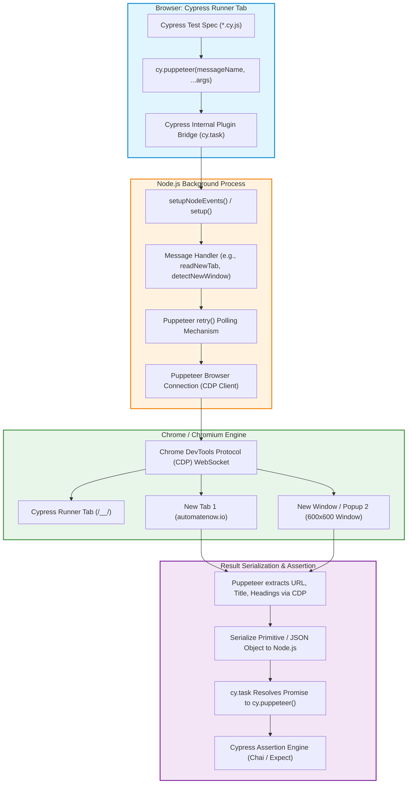

# Cypress Multi-Tab & Multi-Window Architecture

## 1. Architectural Overview

Cypress was fundamentally architected to execute tests inside the **same run loop** as the application under test (AUT). While this design delivers unmatched execution speed, automatic waiting, and direct DOM access, it also imposes an intentional constraint: **Cypress runs inside a single browser tab and iframe, lacking native APIs like Selenium's `switchTo().window()`.**

To test multi-tab workflows, popup windows, and cross-tab interactions without resorting to artificial DOM hacks or brittle workarounds, this framework integrates **`@cypress/puppeteer`**.

`@cypress/puppeteer` establishes an out-of-process bridge between the Cypress test runner (in the browser), the Cypress Node.js backend process, and Chromium's underlying **Chrome DevTools Protocol (CDP)** connection.

---

## 2. End-to-End Communication Flow



---

## 3. Component Responsibilities

| Component | Execution Context | Primary Responsibilities | Limitations |
| :--- | :--- | :--- | :--- |
| **Cypress Test Runner** | Chromium Browser Window (Main Tab) | • Drives the primary test execution loop.<br>• Executes UI interactions (`click()`, `type()`, `should()`).<br>• Runs Mocha/Chai assertion assertions.<br>• Logs step-by-step commands in the Command Log. | Cannot switch browser tabs or access windows outside its parent frame natively. |
| **Node.js Process** | Node.js Runtime (Host OS) | • Hosts `cypress.config.js` and `setupNodeEvents`.<br>• Listens for `cy.task` and `@cypress/puppeteer` message dispatches.<br>• Coordinates asynchronous tasks and lifecycle events.<br>• Serializes and transfers data back to Cypress. | Cannot interact directly with DOM elements without Puppeteer. |
| **Puppeteer (`puppeteer-core`)** | Node.js Runtime | • Maintains active CDP connection to the Chrome browser Cypress started.<br>• Inspects `browser.pages()` across all tabs and windows.<br>• Polls for target tabs via `retry()`.<br>• Evaluates JavaScript inside external pages and closes tabs. | Does not record step-by-step actions in the Cypress Command Log; logs as a single task. |
| **Chromium Browser Engine** | OS Process (Chrome / Chromium) | • Renders pages, manages OS windows, popups, and tab strips.<br>• Executes JavaScript event loops and CSS rendering.<br>• Exposes CDP WebSocket endpoint for external automation. | Subject to browser security sandboxing and extension policies. |

---

## 4. Key Architectural Patterns & Guardrails

### 1. Exclusion of the Cypress Runner Tab
When querying `browser.pages()`, Puppeteer returns every open tab, including the tab hosting the Cypress Test Runner itself (identifiable by the URL fragment `/__/`).
> **Rule:** Handlers must **always** filter out pages whose URL includes `/__/`. Closing or navigating the runner tab will terminate the Cypress test session immediately.

```javascript
const appPages = pages.filter((page) => !page.url().includes('/__/'));
```

### 2. No Persistence of Puppeteer `Page` References
In `@cypress/puppeteer`, message handlers are executed per-invocation over `cy.task()`.
> **Rule:** Never store Puppeteer `Page` instances in global variables across commands. Chrome can close, re-route, or crash pages between command cycles. Always re-query `browser.pages()` freshly inside each handler invocation.

### 3. Serializable Data Transfer
Because Cypress communicates with Node.js via IPC (Inter-Process Communication), data returned from message handlers must be JSON-serializable.
> **Rule:** Return plain objects containing primitive values (`string`, `number`, `boolean`, array of primitives). Never attempt to return circular objects, DOM nodes, or Puppeteer `Page`/`ElementHandle` references.

```javascript
// Valid:
return { url: targetPage.url(), title: await targetPage.title() };

// Invalid:
return targetPage; // Fails serialization!
```

### 4. Asynchronous Retries for CDP Target Discovery
When an application triggers `window.open()`, Chrome spins up an asynchronous OS thread to instantiate the new window and establish the CDP target.
> **Rule:** Always wrap tab queries in `retry()` from `@cypress/puppeteer` to avoid intermittent race conditions. Fixed `cy.wait()` calls are strictly prohibited.
